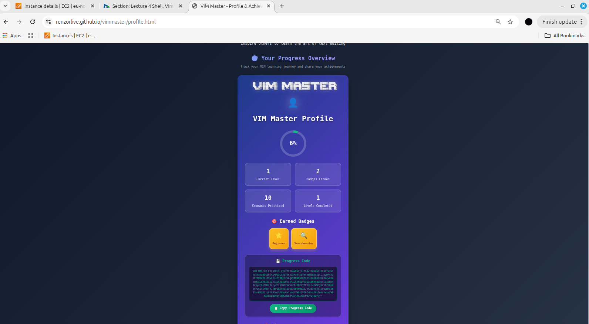

# Lecture 4 - Shell, Vim and Git

## Task 1 - Local Weather Report

### Script Output

```text
LOCAL WEATHER REPORT
--------------------
City: Stockholm
Current Temperature: 6 °C
--------------------
Weather report completed.
```

### Script
The Bash script `weather.sh` detects my location using my IP address and retrieves the current temperature using online weather services.

## Task 2 - Vim Master

### Progress Code

VIM_MASTER_PROGRESS_eyJ2ZXJzaW9uIjoiMS4wIiwidGltZXN0YW1wIjoxNzkzOTAzODEyMTk1LCJiYWRnZXMiOlsiYmVnaW5uZXIiLCJzZWFyY2htYXN0ZXIiXSwicHJhY3RpY2VkQ29tbWFuZHMiOlsid193b3JkX2ZvcndhcmQiLCJoX2xlZnQiLCJqX2Rvd24iLCJrX3VwIiwibF9yaWdodCIsImJfd29yZF9iYWNrd2FyZCIsImlfaW5zZXJ0X21vZGUiLCJzZWFyY2hfZm9yd2FyZCIsInNlYXJjaF9uZXh0Iiwic2VhcmNoX2JhY2t3YXJkIl0sImN1cnJlbnRMZXZlbCI6MCwiY2hhbGxlbmdlTW9kZSI6ZmFsc2UsImNoYWxsZW5nZVBvaW50cyI6MCwieHAiOjAsImNvbWJvIjowfQ==

### Vim Master Profile Screenshot



## Task 3 - GitHub SSH

Configured SSH authentication between my Ubuntu machine and GitHub using an SSH key.

## Task 4 - Git Version Control

Forked and cloned the ICT_WiSe26-27 repository, created my assignment directory, committed my files and pushed them to GitHub.
